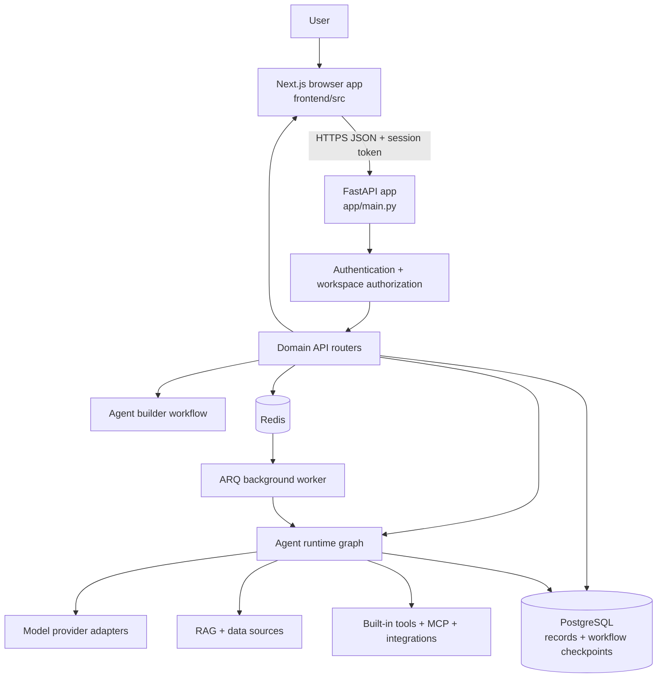
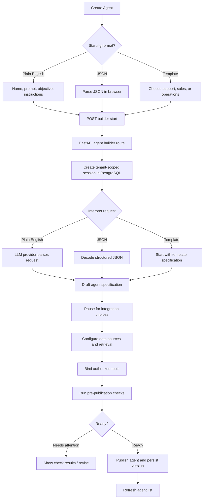
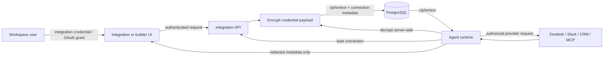
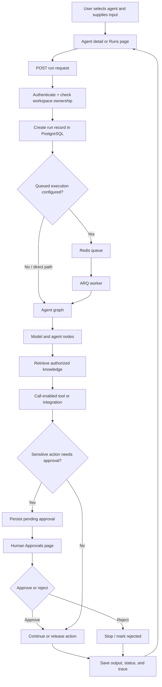
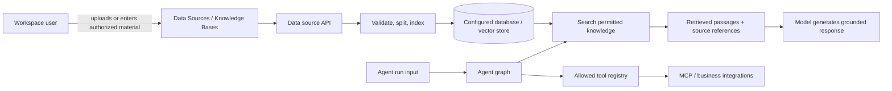
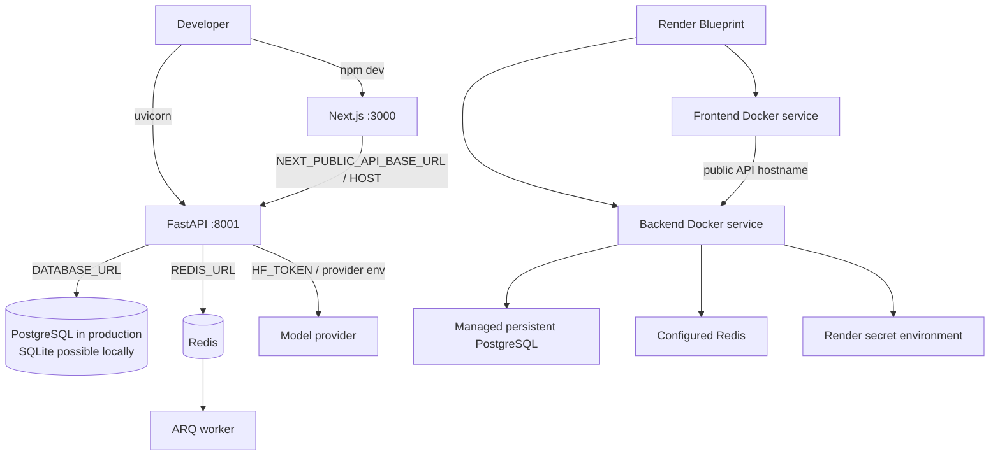

# Operon: A–Z Project Guide

This guide explains the files in this checkout and how the app is intended to work, from describing an agent in plain English to configuring provider API keys. It is based on the source currently present in this folder. It is not a claim that every workflow is fully wired up or deployed.

## 1. What this project is

Operon has a browser app and an API:

- `frontend/` is a Next.js and React application. It displays pages, collects user input, and calls the API.
- `app/` is a Python FastAPI application. It authenticates users, reads and writes workspace data, runs agent workflows, and handles integrations, tools, runs, and approvals.
- PostgreSQL is the intended production source of truth. Redis and ARQ support cache and queued background work. The empty root `operon.db` is a zero-byte file, not a populated database.
- `render.yaml` describes deployment services. Credentials belong in the hosting provider's secret settings or another secure server-side configuration, never in frontend source or `NEXT_PUBLIC_*` variables.

The committed history in this checkout contains a small set of frontend commits. The root `implementation.md` is a list of requested fixes and design notes; it should be read as a work brief, not as proof that all those items were completed. The working tree currently also contains untracked `app/`, `implementation.md`, `operon.db`, and `.worktrees/` entries.

## 2. Creating an agent: the intended journey

The main builder is `frontend/src/components/operon/AgentBuilderWorkspace.js`, opened from the Create Agent button in `frontend/src/app/operon/page.js`. It offers three starting points: plain English, JSON, and a preset template.

1. **Describe the work.** In plain-English mode, the user supplies a name, a description of what the agent should do, a business objective, and extra instructions. JSON mode parses a JSON specification in the browser before sending it. Template mode starts from an archetype such as customer support, sales, or operations.
2. **Start the builder session.** The frontend calls `operonApi.builder.start(...)` in `frontend/src/api/operon.js`. The request goes through `frontend/src/api/client.js` to the configured backend host.
3. **Interpret and draft.** `app/api/routers/operon_agents.py` creates a tenant-scoped builder session. `app/agents/workflows/agent_builder_workflow.py` keeps the state and stages. Plain English is passed to `app/services/llm_provider.py` for specification parsing; JSON is parsed as JSON; templates provide a predefined starting spec. The workflow can pause and resume at questions requiring user input.
4. **Set up integrations.** The builder can identify required systems and ask the user to authorize them. Integration catalog and connection routes live in `app/api/routers/operon_integrations.py`; provider setup logic is in `app/services/integration_service.py` and OAuth helpers are in `app/services/oauth2.py`.
5. **Choose data and knowledge.** The user configures data sources and retrieval. `app/api/routers/operon_datasources.py`, `app/rag/ingestion.py`, `app/rag/retrieval.py`, and `app/rag/augumentation.py` implement the backend data/retrieval path. Knowledge and data source screens are `KnowledgeBasesView.js` and `DataSourcesView.js`.
6. **Bind tools and MCP servers.** The user selects allowed tools or connects an MCP server. Frontend controls are in `ToolsMcpManager.js`; API routes are in `operon_tools_mcp.py`; client and protocol handling are in `app/mcp_servers/`.
7. **Evaluate and publish.** The builder workflow runs configuration checks, records its readiness state, and exposes publish actions. Evaluations are handled by `operon_evaluations.py` and `app/services/evaluation_service.py`. Agent records and versions are created through `operon_agents.py` and stored in PostgreSQL models.
8. **Run, inspect, and approve.** A published agent can be triggered from its detail view or Runs page. The API stores runs and traces. Sensitive actions can create approval records, which appear on the Human Approvals page and are decided through `operon_approvals.py`.

The separate `AgentWizard.js` is an older, template-oriented six-step wizard. The Operon route currently opens `AgentBuilderWorkspace.js`; the older wizard remains in the source but is not the main builder shown by this route.

## 3. API keys and credentials (the “Pi keys” step)

There are different kinds of credentials; they are not interchangeable:

- **Model/provider key:** the backend's `app/services/hf_inference.py` reads `HF_TOKEN` from the server environment when it calls Hugging Face inference. `app/services/llm_provider.py` handles model specification parsing and provider selection. The frontend sends a model name, not a secret token.
- **Third-party integration credentials:** Zendesk, Slack, CRM, email, and other connector credentials authorize access to the connected customer service. The integration catalog declares provider auth types and required fields. The API manages connection records; `app/services/secret_vault.py` encrypts credential dictionaries with a Fernet key derived from the server `SECRET_KEY` and masks secret-like values in returned data.
- **Application signing secret:** `SECRET_KEY` signs login/session JWTs and is also currently the root used by the vault key derivation. It is a server-side secret and must be stable and protected in deployment.
- **Database/Redis credentials:** `DATABASE_URL` and `REDIS_URL` are backend runtime connection settings, not model or integration keys.

Never paste real keys into source files, commit them, or put them in a browser-exposed environment variable. If an integration uses OAuth, the user authorizes the provider through its OAuth flow; an API token field is only appropriate for providers whose auth type supports one. The vault code shown here encrypts credential data at rest, but actual protection also depends on securely setting and rotating `SECRET_KEY` and on the integration route correctly storing credentials.

## 4. Pages and screens

### Public and account pages (`frontend/src/app/`)

- `/` — `page.js`; public landing or redirect entry point.
- `/login` — `login/page.js` renders the login flow, using `LoginPage.js` and/or `features/auth/LoginForm.js`.
- `/signup` — account creation via `signup/page.js`, `SignupPage.js`, and `features/auth/SignupForm.js`.
- `/forgot-password` — password recovery page.
- `/admin` — legacy/admin overview page.
- `/admin/login` and `/admin/signup` — separate admin account entry screens.
- `/operon` — authenticated workspace shell and main product. It contains tabs rendered in-place rather than separate URL routes: Dashboard & Agents, Runs, Human Approvals, Data Sources, Knowledge Bases, Tools & MCP, Admin Console, Workspace Settings, and selected Agent Details.

### Main workspace tabs (`frontend/src/components/operon/`)

- `OperonDashboard.js` — workspace metrics, agent cards, recent runs, and entry point to create an agent.
- `AgentBuilderWorkspace.js` — plain-English, JSON, and template agent creation plus resumable workflow UI.
- `AgentWizard.js` — older six-step template builder.
- `AgentDetailView.js` — selected agent overview, configuration, versioning, test/run and evaluation controls, integrations/tools, and deletion.
- `RunsView.js` — filters and lists real runs and opens a run detail modal; can trigger a run.
- `LiveRunModal.js` — run status, output, execution steps, and trace details.
- `ApprovalsView.js` — pending and decided human review items, with approve/reject actions.
- `DataSourcesView.js` — connect and manage data sources and provide data for agent retrieval.
- `KnowledgeBasesView.js` — create and manage agent knowledge bases and their documents.
- `ToolsMcpManager.js` — tool catalog and enablement, MCP server connections and discovered tools, plus tool requests.
- `IntegrationsView.js` — provider catalog, connection state, connect/disconnect, and connection tests.
- `PlatformAdminConsole.js` — platform-level tenant, metric, and tool request administration.
- `OperonNavbar.js` — workspace switch, theme control, page heading, and Create Agent action.
- `OperonSidebar.js` — tab navigation, workspace identity, agent shortcuts, pending approval count, and logout.

### Other frontend components

- `Dashboard.js`, `TicketsManager.js`, `UserTicketsDashboard.js`, `SubmissionForm.js`, `Processed_ticket.js`, `IncidentsManager.js`, `HITLWorkspace.js`, `EngineerResolutionForm.js`, `KnowledgeHealthView.js`, and `AnalyticsView.js` are legacy/support-ticket or incident workflows outside the newer Operon tab components.
- `AdminLoginPage.js`, `AdminSignupPage.js`, `AdminOverview.js`, `UsersManager.js`, and `CustomerDetailModal.js` support the older admin and customer management screens.
- `SettingsView.js` is the older general settings view; `features/settings/OperonSettingsView.js` is the settings screen used in the Operon workspace.
- `components/ui/` contains reusable status, priority, SLA, confidence, AI status, empty state, loading skeleton, decision explanation, and logo UI pieces.

## 5. Frontend file map

- `frontend/src/app/` — Next.js route files, root `layout.js`, app metadata/icons, and page entry points.
- `frontend/src/api/client.js` — HTTP client, auth headers, base URL, and error handling. `endpoints.js` names routes; `operon.js` groups product API calls; `tickets.js` groups ticket calls; `index.js` is an API export surface.
- `frontend/src/context/OperonContext.js` — signed-in user, workspace list/current workspace, and session handling. `AppContext.js` is older app-level state. `ThemeContext.js` stores/coordinates theme preference.
- `frontend/src/features/auth/` — reusable login and signup forms. `features/settings/` — workspace settings screen.
- `frontend/src/services/fetch_tickets.js` — older ticket-fetch service.
- `frontend/src/utils/auth.js` and `customer.js` — auth and customer helpers. `src/types/index.js` holds shared data/type definitions despite the `.js` extension.
- `src/config.js` — frontend configuration. `src/index.css`, `tailwind.config.js`, and `postcss.config.js` — global styles and CSS tooling. `next.config.mjs` — Next.js build settings.
- `src/assets/hero.png` and `public/` — static images and brand assets. `public/logo.png`, `logo-icon.png`, `favicon.svg`, `icons.svg`, plus `src/app/icon.svg` and `favicon.ico` are branding/browser assets.
- `package.json` and `package-lock.json` — frontend scripts and pinned dependency tree. `README.md` — local frontend setup and deployment notes.

## 6. Backend file map

### API entry and routes

- `app/main.py` — creates the FastAPI app, starts/stops Redis, ARQ, PostgreSQL checkpointing and the scheduler, enables CORS, and includes routers.
- `app/api/routers/operon_auth.py` — tenant/workspace login and session endpoints. `authentication.py`, `admin.py`, `internal_admin.py`, `admin_fetch_tickets.py`, `users.py`, and `tickets.py` cover older account, admin, user, and ticket APIs.
- `operon_agents.py` — agent catalog, create/update/detail, activation, builder session start/resume/chat/publish, and dashboard stats.
- `operon_runs.py` — run triggering, listing, and detail/trace APIs.
- `operon_approvals.py` — human approval queue and decision APIs.
- `operon_integrations.py` — integration provider catalog and tenant connections.
- `operon_datasources.py` — tenant data sources and knowledge documents.
- `operon_tools_mcp.py` — tools, MCP server registration/discovery, approvals, and tool requests.
- `operon_evaluations.py` — agent evaluation scenarios/results.
- `operon_platform_admin.py` — platform tenant metrics and admin actions.
- `models.py` — legacy model health endpoints.

### Agent runtime, tools, and knowledge

- `app/agents/graph.py` — assembles the agent execution graph. `state.py` defines data passed between graph stages; `context.py` prepares context.
- `agents/nodes/` — triage, retrieval (RAG), vision, classification, evaluation, and human escalation graph steps.
- `agents/runners/` — sales and operations agent execution logic. `agents/adapters/support_adapter.py` adapts support workflows.
- `agents/workflows/agent_builder_workflow.py` — the resumable builder stages and pre-publication configuration checks.
- `services/tool_registry.py` — known tools and their metadata. `services/integration_service.py` — connector behavior. `services/llm_provider.py` — model choice and plain-English parsing. `services/hf_inference.py` — Hugging Face inference/embeddings client.
- `services/secret_vault.py` — credential encryption and redaction. `services/oauth2.py` — JWT and current-user/admin token validation. `services/evaluation_service.py` — evaluation behavior. `services/telemetry.py` and `services/utils.py` — telemetry and common helpers.
- `rag/ingestion.py`, `retrieval.py`, and `augumentation.py` — load/index knowledge, retrieve relevant material, and assemble augmented context. `enterprise_knowledge.pdf` is a bundled sample/reference document; it is not evidence of a customer's uploaded knowledge.
- `mcp_servers/mcp_client.py`, `mcp_protocol.py`, and `operon_mcp_server.py` — connect to MCP services, speak protocol, and expose Operon's own MCP server.

### Data, migrations, and background work

- `database/postgres/config.py` — environment-based settings and database/Redis URL resolution. `database.py` — SQLAlchemy engine/session helpers and database access. `models.py` — persisted users, tenants, agents, versions, integrations, data sources, runs, approvals, and builder records.
- `alembic.ini`, `alembic/env.py`, and `alembic/script.py.mako` — migration configuration and template. `alembic/versions/` — schema migration history. `alembic/README` — migration notes.
- `api/background_tasks/arq_worker.py` — queued job worker. Other background task modules save ticket lifecycle records, send responses, escalate, calculate semantic differences, and detect drift.
- `cache.py` — Redis cache setup. `redis.conf` and `compose.yaml` — local Redis/container configuration.
- `app/Dockerfile` — backend container build. `requirements.txt` — Python dependencies. `app/package.json` and `package-lock.json` are Node dependency metadata present in the backend folder; inspect their scripts before assuming they are required to run the Python API.
- `paths.py` — application path utilities. `verify_operon_backend.py` — repository/backend verification helper.

## 7. Root files and the backend worktree

- `README.md` — project overview, architecture, deployment outline, and local setup pointers.
- `implementation.md` — earlier list of requested product fixes (appearance, real data, deleted agents, approvals, knowledge, MCP, JSON form layout, PostgreSQL source of truth). Treat this as the user's requirements record.
- `render.yaml` — Render service blueprint.
- `LICENSE` — project licensing terms.
- `operon.db` — currently empty; do not mistake it for the PostgreSQL production database.
- `.git/` — current repository history and metadata.
- `.worktrees/backend/` — separate Git worktree containing another backend checkout, its own `.git` marker, `README.md`, `LICENSE`, and `app/`. It is a second working copy, not part of the normal `app/` tree; compare it before editing or assuming both copies are in sync.
- `.worktrees/` itself is currently untracked according to `git status`.

## 8. How to run locally

Frontend instructions are in `frontend/README.md`: use Node.js/npm, enter `frontend/`, install with `npm ci`, then run `npm run dev` and open `http://localhost:3000`. The default API host is `http://localhost:8001`.

The backend guide linked by the README is external to this checkout. Backend startup requires Python dependencies, PostgreSQL settings, and optionally Redis/ARQ and a model provider token. Review `app/database/postgres/config.py`, `app/compose.yaml`, and deployment environment before starting it. The frontend alone cannot provide database-backed product data.

## 9. Reading status and limits correctly

The source describes a wide product surface, including legacy ticket flows and newer agent-builder flows. A page component existing does not guarantee its backend operation is complete, provider credentials are configured, or a deployment is healthy. In particular, the current builder's UI and backend should be reviewed together before assuming every plain-English specification, integration credential prompt, data-source setting, tool binding, evaluation, and publish step is fully connected. This guide explains the code structure and the recorded intentions; it does not certify runtime behavior.

## 10. Architecture at a glance

**How to read it:** the browser asks the API to do work. The API checks who the user is and which workspace they can access. The backend then reads or changes records and may call models, data retrieval, tools, or background workers. PostgreSQL holds the durable product state; Redis is used for queue/cache support. Results, run state, and approval decisions return to the browser.

**Tradeoffs:** a separate frontend and API lets each deploy independently and keeps provider secrets on the server, but API host, CORS origin, auth, and version compatibility must line up. A worker keeps longer work out of request handling and can scale separately, but adds Redis and worker availability as dependencies. PostgreSQL provides shared, durable state for concurrent use; SQLite makes a local setup easier but is not an appropriate production source of truth. The current backend setting defaults to SQLite, while the docs and deployment describe PostgreSQL for production, so the runtime environment must explicitly set the production database URL.

## 11. Plain-English to published agent: end-to-end flow

The front-end file that starts these modes is `AgentBuilderWorkspace.js`. `operon_agents.py` exposes start, resume, chat, recover, and publish operations; `agent_builder_workflow.py` carries the stage and paused state. The workflow code stores `AgentBuilderSession` and the draft specification in the configured database so it can resume after a page refresh. The agent itself and immutable versions are stored through the agent routes and SQLAlchemy models.

**Tradeoffs and current boundaries:** Plain English reduces the amount of configuration a user must know, but the generated spec depends on the selected model, its availability, and the quality of the prompt. JSON gives the user precise control and predictable parsing, but requires valid structure. Templates are fast and consistent but can start with assumptions that need editing. A resumable staged flow makes missing information visible, but each pause/resume boundary needs reliable persistence and clear validation. The backend's readiness checks are configuration checks (instruction length, knowledge tool binding, approval policy, and model label); a passing score alone does not prove a real provider, integration, or tool call works. The older `AgentWizard.js` follows a different six-step flow and is not the component opened by `/operon` today.

## 12. Key and credential flow (API keys included)

There are several separate credentials in this project:

| Credential | What it unlocks | Where the code points |
| --- | --- | --- |
| `HF_TOKEN`, `GROQ_KEY`, `META_KEY`, `QWEN_KEY`, `GOOGLE_AI_KEY` | Model or inference provider calls, depending on the selected adapter | `app/database/postgres/config.py`, `app/services/llm_provider.py`, `app/services/hf_inference.py` |
| Integration credentials (for example Zendesk token or Slack OAuth token) | A customer's external business systems | provider catalog/routes in `operon_integrations.py`, connection logic in `integration_service.py`, encryption/redaction in `secret_vault.py` |
| `SECRET_KEY` | Signs JWT session tokens; also derives the current vault encryption key | `oauth2.py`, `secret_vault.py`, `database/postgres/config.py` |
| `DATABASE_URL`, `REDIS_URL` | Connects the backend to its database and queue/cache | `database/postgres/config.py` |
| Personal Operon API key | Would authenticate a programmatic caller to a workspace | `PlatformAPIKey` model exists in `database/postgres/models.py`; the inspected `app/api/routers/` files do not expose an evident create/list/rotate/revoke API-key route |

The phrase “API key” can refer to either an Operon-issued caller key, a model-provider key, or a third-party integration token. In this checkout those have different purposes. The model has a `PlatformAPIKey` record with a hash and visible prefix, which is the right general pattern for an Operon-issued key, but the folder does not show an API route or page for managing those keys. Do not assume that such a feature is usable just because the database model exists.

**Security tradeoffs:** keeping provider keys on the backend avoids shipping them to browser code, but requires correct server environment setup and access controls. Hashing an issued API key allows verification without storing its raw value, but means the raw key can only be shown once when created. Encrypting integration tokens at rest allows later decryption for provider calls, but means the encryption secret is critical: because the current vault derives its Fernet key from `SECRET_KEY`, rotating that secret can make existing encrypted integration credentials unreadable unless there is a planned re-encryption/migration. Redaction helps prevent accidental exposure in API responses and logs, but should not be treated as a substitute for authorization, safe logging, and secret rotation.

## 13. Agent run, human review, and feedback loop

`RunsView.js` triggers and filters runs; `LiveRunModal.js` presents an individual trace; `ApprovalsView.js` shows review items and submits decisions. Backend run, approval, and evaluation endpoints are in `operon_runs.py`, `operon_approvals.py`, and `operon_evaluations.py`. The agent graph is assembled in `app/agents/graph.py`; reusable state, nodes, runners, and adapters live under `app/agents/`.

**Tradeoffs:** human gates reduce the chance that an agent silently performs a sensitive action, but add waiting time and require approval records to remain consistent with run state. Persisted traces help explain outcomes and debug behavior, but increase storage needs and may contain sensitive user input; retention and redaction policy matter. Queued execution improves responsiveness and retry options, but operators must monitor Redis, ARQ workers, and failed jobs.

## 14. Knowledge, retrieval, and tool boundaries

`DataSourcesView.js` is for data connection and ingestion setup. `KnowledgeBasesView.js` is for curated material that agents can retrieve. Backend ingestion, retrieval, and augmentation files are under `app/rag/`; datasource APIs are in `operon_datasources.py`. Tool enablement and MCP management are in `ToolsMcpManager.js`, `operon_tools_mcp.py`, and `app/mcp_servers/`.

**Tradeoffs:** retrieval can ground responses in workspace material without putting every document in every model prompt, but index quality, freshness, access filters, and source tracking determine whether it retrieves the right material. Hybrid search can balance keyword matching with semantic similarity, but adds indexing and tuning complexity. A tool allowlist limits what each agent may do, but every tool needs clear input validation and tenant authorization. Connecting an MCP server expands capabilities, but also expands the trust boundary to an external server and its network/auth configuration.

## 15. What is in each checkout: root vs `.worktrees/backend/`

The root folder is the active frontend-oriented checkout: it contains `frontend/`, `render.yaml`, root `README.md`, and the currently present root `app/` backend files. `.worktrees/backend/` is a linked Git worktree on the backend branch, with its own backend README and another `app/` tree. It is not a second service that runs automatically; it is another checked-out copy of the backend source.

The two backend `app/` trees were compared file-by-file by relative path and SHA-256 during this update. Each has 81 source files (excluding Python cache files), and all paths are present in both. Seven files differ at the byte level. Most differences are whitespace-only in `services/llm_provider.py`, `services/telemetry.py`, `api/routers/operon_datasources.py`, `api/routers/operon_agents.py`, and `agents/workflows/agent_builder_workflow.py`. Two differences affect runtime configuration:

- `app/main.py` in `.worktrees/backend/` reads `FRONTEND_HOST` and adds it to allowed CORS origins. Root `app/main.py` does not. That matters for the Render frontend domain configured in `render.yaml`.
- `.worktrees/backend/app/Dockerfile` exposes and defaults to port `10000`; root `app/Dockerfile` exposes and defaults to `8001`. Render commonly supplies `PORT`, but local/container behavior differs when it is absent.

The nested backend checkout also has its own backend README and license at its root. The two copies are therefore similar, not perfectly interchangeable. Keep edits synchronized only when that is intentional, because branch changes and future commits can make them diverge further.

### Root checkout inventory

- `frontend/` — the browser application, pages, reusable UI, API client, assets, and frontend README/package files described above.
- `app/` — the API and runtime. Its complete source groups are: `api/routers/` (account/admin plus Operon agent, auth, approval, data, integration, run, tool/MCP, evaluation routes), `api/background_tasks/` (ARQ worker and ticket save/send/escalation/drift tasks), `agents/` (graph, state, nodes, runners, adapter, builder workflow), `database/postgres/` (settings, engine/session, ORM models), `mcp_servers/` (client/protocol/server), `model/schemas/` (account, health, and request schemas), `rag/` (ingestion, retrieval, augmentation, bundled PDF), `services/` (LLM, Hugging Face, integrations, vault, OAuth, evaluation, tools, telemetry, utilities), Alembic migrations, and app/runtime files (`main.py`, `cache.py`, `paths.py`, `Dockerfile`, `compose.yaml`, `redis.conf`, `requirements.txt`, npm metadata, backend verifier).
- `README.md` — overall system design and links/setup.
- `implementation.md` — original user issue/fix checklist. It records the desired corrections: remove generic data, make PostgreSQL authoritative, fix page and deletion behavior, improve light theme/approval colors, make user-added knowledge and MCP behavior accurate, and correct the JSON input layout.
- `render.yaml` — blueprint for separate frontend and backend Docker services. It references separate remote Git repositories and branches, so actual deployment source is controlled by those service definitions, not necessarily by every uncommitted file in this local folder.
- `LICENSE` — license text. `operon.db` — empty zero-byte file at inspection time.
- `.git/` — root repository metadata. `.worktrees/` — linked checkouts; `backend/` is documented below.
- `PROJECT_GUIDE.md` — this guide.

### `.worktrees/backend/` inventory

- `.git` — a Git worktree pointer to the shared repository's `.git/worktrees/backend` metadata; it is not a standalone `.git` directory.
- `README.md` — backend-focused setup, environment variables, local Compose instructions, deployment notes, and explicit technical tradeoffs (SQLite vs PostgreSQL, Redis/ARQ, providers, split deployments).
- `LICENSE` — backend checkout's license file.
- `app/` — duplicate backend tree containing the same groups listed above: API routers/background tasks, agent workflow/runtime, Alembic, PostgreSQL config/database/models, MCP, schemas, RAG, provider/services, Docker/Compose/Redis config, dependency manifests, paths, and verification helper.

### Git state matters

The root Git status showed the current frontend files as deleted relative to the checked-out backend branch, while `.worktrees/backend/` is on `feat/core-backend-implementation`. This means the two paths have different checkout/index contexts even though their backend file inventories are currently the same. Treat `git status` in each worktree independently, and avoid assuming a path marked deleted in one worktree is deleted from the other. This guide documents files as present on disk and does not change branch or worktree state.

## 16. Deployment and local services flow

Root `render.yaml` defines independent frontend and backend services, while the backend's `app/compose.yaml` defines API, worker, and Redis for local/container development. The frontend README explains npm setup and public API host settings; the backend worktree README gives Python setup and environment variables.

**Tradeoffs:** independent services can scale and deploy separately, but require cross-service configuration and matching CORS. Docker packages runtime dependencies consistently, but a frontend setting prefixed `NEXT_PUBLIC_` is compiled into browser code and therefore must contain only public configuration. Managed persistent PostgreSQL and externalized secrets survive container replacement; local container files do not. The API `/` health endpoint only confirms that the process responds, not that PostgreSQL, Redis, a model, or an integration is reachable.

## 17. Requirements recorded in `implementation.md`

The checklist is historical user intent rather than a current acceptance report. It asks for: correct brand logos/favicon; eliminate undefined success-rate and fabricated generic data; align approval status colors and make rejection persist; improve light mode while preserving dark mode; make knowledge user-supplied and agent-focused; let users add MCP servers; remove stale deleted agents; repair blank help desk and agent pages; make PostgreSQL the source of truth; and place JSON description input inside its intended question/div. The frontend and backend files above are the places to inspect for these behaviors. A full functional audit would require tracing each UI action to its API and database behavior and exercising it against a configured backend.
