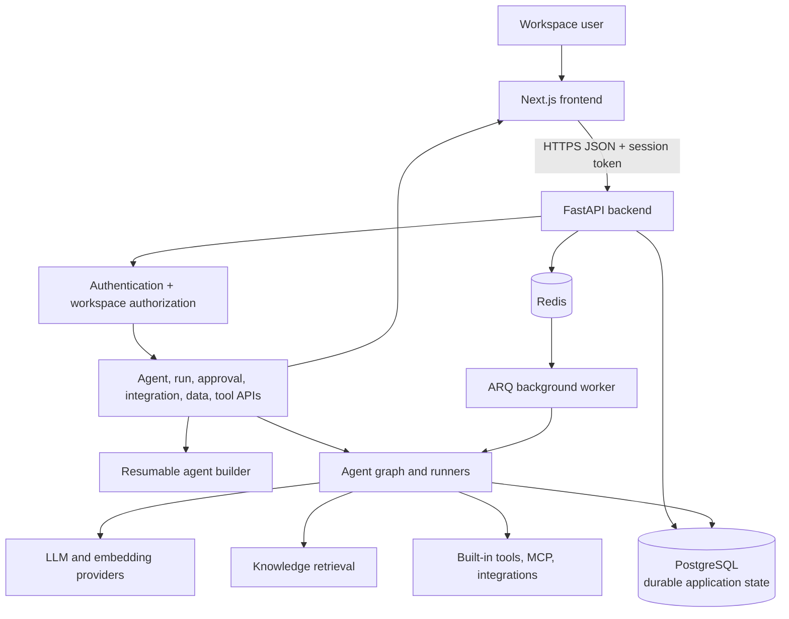
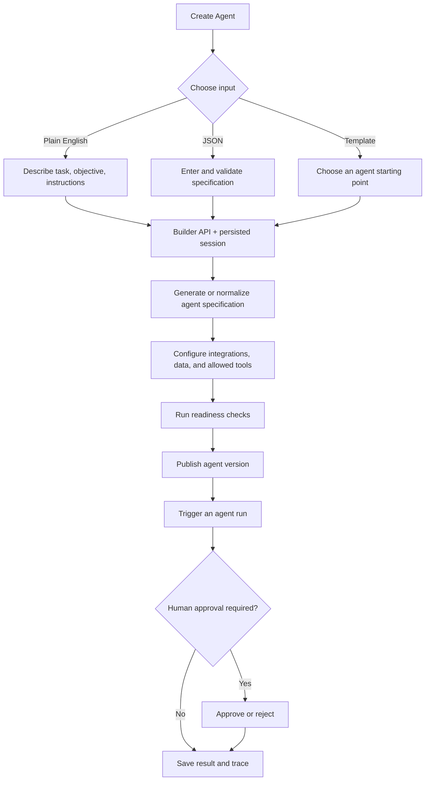

# Operon

Operon is a platform for building and operating AI agents. Users define agents in plain English, JSON, or from a template; connect approved data, business integrations, and tools; publish and run agents; and review executions that need human approval.

The product is split into a Next.js browser application and a FastAPI backend. The browser collects input and displays workspace data. The backend authenticates the user, enforces workspace access, calls model providers and tools, and persists product state. See the [frontend guide](frontend/README.md) and the [backend guide](https://github.com/Operon-Operation-Platform/backend/blob/feat/core-backend-implementation/README.md) for service-specific details.

## Architecture

The browser and backend deploy independently. PostgreSQL is the production source of truth for workspace, agent, run, approval, integration, and builder-session records. Redis supports cache and queued background work; it is not a substitute for durable application records. The API's `/` endpoint reports that the process answers HTTP requests, not that every dependency is healthy.

## Agent creation and execution

The main builder is `frontend/src/components/operon/AgentBuilderWorkspace.js`; `/operon` opens it from the Create Agent control. The backend builder endpoints are in `app/api/routers/operon_agents.py`, and the resumable workflow lives in `app/agents/workflows/agent_builder_workflow.py`. The older `AgentWizard.js` is a separate template-oriented wizard and is not the builder opened by that route.

The workflow interprets plain English through the configured model provider, parses JSON as structured input, or starts from a template. It then collects required integration and data configuration, binds tools, checks readiness, and publishes an agent. A readiness score is not proof that a real model, provider credential, external integration, or tool is healthy; those dependencies need their own configuration and checks.

## Main workspace pages

The `/operon` route is a shared shell whose tab content is rendered in the page:

| Page | Purpose |
| --- | --- |
| Dashboard & Agents | Workspace metrics, agent list, recent runs, and agent creation. |
| Agent Details | Agent configuration, versions, test/run controls, evaluations, integrations, tools, and deletion. |
| Runs | Trigger and filter persisted runs. |
| Live Run Details | Inspect one run's output and available execution trace. |
| Human Approvals | Review pending sensitive actions and inspect decided requests. |
| Data Sources | Configure external or database sources for agents. |
| Knowledge Bases | Add and manage agent retrieval material. |
| Tools & MCP | Enable tools, connect MCP servers, and request tools. |
| Integrations | Connect and test supported business providers. |
| Platform Admin | Review platform metrics, tenants, and tool requests. |
| Workspace Settings | Manage workspace-level settings. |

The source also contains older ticket/incident screens and separate admin login/signup pages; their components are documented in the [A–Z project guide](PROJECT_GUIDE.md).

## API keys and secret handling

“API key” can mean different credentials in this system:

- Model provider tokens such as `HF_TOKEN`, `GROQ_KEY`, `META_KEY`, `QWEN_KEY`, and `GOOGLE_AI_KEY` let the backend call model services.
- Integration credentials authorize access to a customer's Zendesk, Slack, CRM, email, or other provider account.
- `SECRET_KEY` signs application JWTs and currently also derives the Fernet key used by the secret vault.
- `DATABASE_URL` and `REDIS_URL` connect backend services; they are not model keys.
- The ORM has a `PlatformAPIKey` model intended for a hashed, workspace-scoped Operon caller key. The inspected router set does not show a create/list/rotate/revoke API for managing it, so do not assume user-managed Operon API keys are available.

Keep all credentials server-side in deployment secrets or a protected local environment file. Never commit actual values or place secrets in `NEXT_PUBLIC_*` settings. The frontend sends requests to the API; it should not receive provider credentials. Integration credentials are encrypted and redacted by `app/services/secret_vault.py`. Since that vault derives its encryption key from `SECRET_KEY`, rotation needs a plan to re-encrypt existing values.

## Repositories and folders

- `frontend/` — Next.js pages, components, API client, styles, assets, and frontend setup guide.
- `app/` — FastAPI routes, agent runtime and builder, PostgreSQL models, RAG, MCP, provider services, background work, and migrations. The frontend and backend are maintained/deployed as separate services and Git repositories.
- `.worktrees/backend/` — linked backend worktree with its own backend README and `app/` source copy. In the current checkout its source inventory matches the root `app/` inventory, but some runtime files differ: the worktree version reads `FRONTEND_HOST` for CORS and defaults its Docker container to port `10000`; root `app/` defaults to `8001`. See the backend README before selecting which copy to deploy.
- `render.yaml` — Render Blueprint referencing separate frontend and backend repositories/branches.
- `implementation.md` — original requested UI and behavior fixes; it is a requirements note, not a completion report.
- `PROJECT_GUIDE.md` — detailed A–Z inventory, diagrams, flow explanations, and tradeoffs in this local project checkout.

## Local development

Start the frontend and backend separately. Frontend setup is in [`frontend/README.md`](frontend/README.md). Backend setup and Compose instructions are in the [backend README](https://github.com/Operon-Operation-Platform/backend/blob/feat/core-backend-implementation/README.md). The local frontend defaults to `http://localhost:8001` for the API. Production should use persistent PostgreSQL, configured Redis if background work is enabled, and server-side secrets.

## Architecture tradeoffs

- **Separate browser and API services:** lets UI and model/runtime code deploy and scale independently and keeps provider secrets server-side. It requires API host, CORS, auth, and service versions to agree.
- **PostgreSQL for durable state:** supports shared, concurrent production use and is the source of truth. SQLite can simplify local development but container-local SQLite is not durable production storage.
- **Redis and ARQ:** keep queued work out of the request path and allow workers to scale separately. They add an operational dependency and require monitoring/retry handling.
- **Provider adapters:** centralize model calls and secret use on the backend. Model-backed features depend on valid credentials, provider availability, and network access.
- **Retrieval and tool allowlists:** provide relevant workspace material and constrain what agents can do. Quality depends on current indexed data, tenant-aware access checks, and carefully validated tools.
- **Human approval gates:** give people control over sensitive actions, at the cost of additional wait states and the need to keep approval and run status consistent.
- **Separate frontend/backend repositories:** support independent release cycles, but deployment branches can drift. The local root and `.worktrees/backend/` copies already have different CORS and Docker port behavior, so verify the intended copy before release.

## Deployment notes

The Render Blueprint defines separate Docker services and passes the backend hostname to the frontend as public build configuration. `NEXT_PUBLIC_*` values are embedded in browser output; use them only for public endpoints. Set `SECRET_KEY`, database/Redis URLs, and model/integration credentials through the hosting provider's secret settings. Use persistent managed PostgreSQL in production. Confirm the backend permits the deployed frontend origin and test a representative authenticated workflow; an HTTP health check alone does not verify dependencies.
