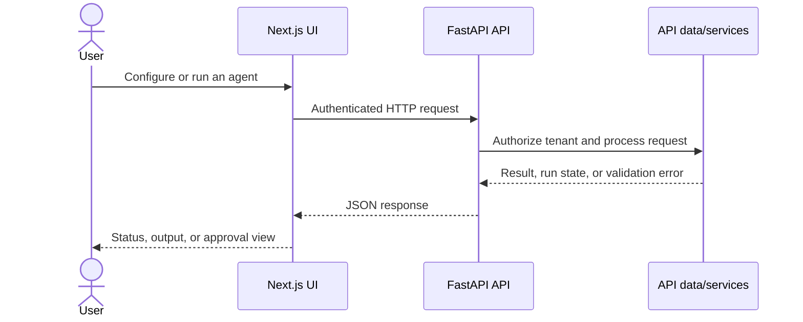
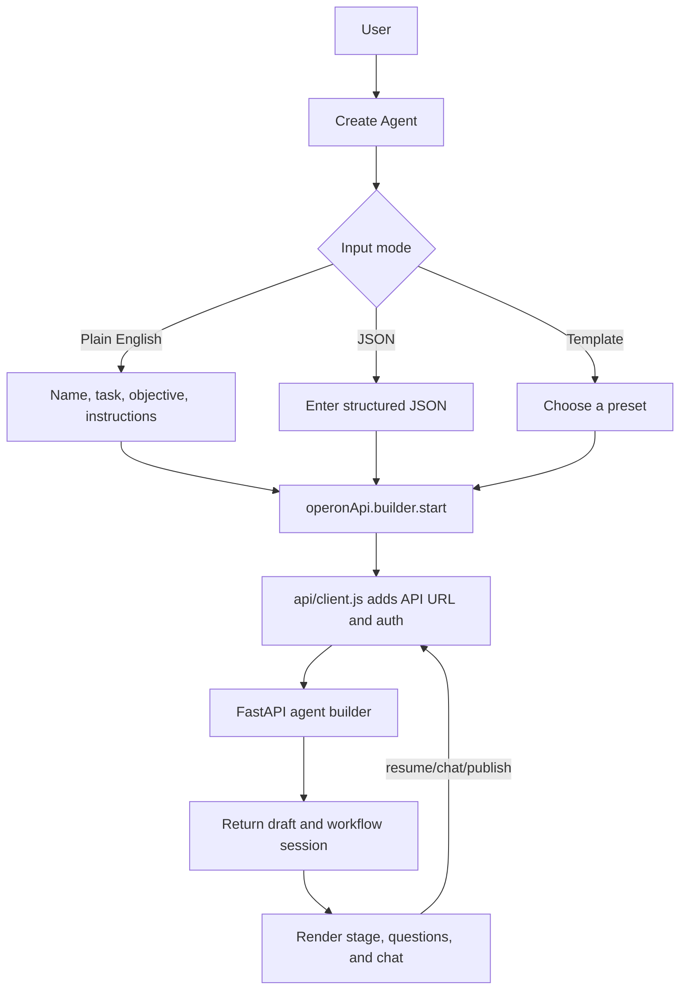

# Operon Frontend

The frontend is a Next.js application for configuring agents, managing integrations and data sources, testing agents, reviewing approvals, and following runs. It communicates with the Operon FastAPI backend; it does not contain backend credentials or execute model work itself.

## Requirements

- Node.js 22 or a compatible current LTS release
- npm
- A running Operon API for authenticated and data-backed features

## Local setup

From the repository root:

```powershell
cd frontend
npm ci
npm run dev
```

Open `http://localhost:3000`. By default, API requests target `http://localhost:8001`. See the [backend guide](https://github.com/Operon-Operation-Platform/backend/blob/feat/core-backend-implementation/README.md) to start the API.

## Configuration

The API base URL is selected in this order:

1. `NEXT_PUBLIC_API_BASE_URL` — full API base URL.
2. `NEXT_PUBLIC_API_HOST` — host name, to which the app adds `https://`.
3. Local default — `http://localhost:8001`.

`NEXT_PUBLIC_*` settings are exposed to browser code and embedded during the Next.js build. Set only public values there. Never put API keys, signing secrets, or user credentials in frontend variables.

## Useful commands

```bash
npm run dev       # local development server
npm run lint      # Oxlint checks
npm run build     # production build
npm start         # serve the standalone build after building
```

## Request flow



## Build and deployment

The Docker image uses Next.js standalone output to keep the runtime image focused on the production server. The container listens on port `10000` (or the `PORT` supplied by the host). The Render Blueprint builds the frontend separately and supplies the backend hostname as a public setting.

Because `NEXT_PUBLIC_*` values are build-time public configuration, changing the API hostname requires a new frontend build/deploy. The API must allow requests from the deployed frontend origin. Update the backend's allowed frontend host if the Render service name or public domain changes.

## Trade-offs and boundaries

- **Standalone Next.js output:** provides a compact production runtime, while requiring the image to be built with the intended public API host.
- **Browser-to-API requests:** keep model/provider credentials on the server and allow the UI and API to scale independently. The API must enforce authentication, tenant access, and origin policy.
- **No production mock fallback:** the UI expects the backend for real account and agent data. A reachable frontend alone does not mean API-backed workflows are available.

## Related documentation

- [Project overview](../README.md)
- [Backend guide](https://github.com/Operon-Operation-Platform/backend/blob/feat/core-backend-implementation/README.md)

## Product pages

The App Router pages under `src/app/` provide the public landing page, login, signup, forgot-password, admin login/signup/overview, and `/operon`. The `/operon` route is an authenticated workspace shell; its product areas are tabs rendered in that shell:

| Workspace area | Main component | What it does |
| --- | --- | --- |
| Dashboard & Agents | `components/operon/OperonDashboard.js` | Shows workspace metrics, agents, recent runs, and create-agent entry point. |
| Agent creation | `components/operon/AgentBuilderWorkspace.js` | Starts from plain English, JSON, or a template and guides a resumable setup workflow. |
| Agent Details | `components/operon/AgentDetailView.js` | Shows configuration, versions, test/run controls, evaluation history, integrations/tools, and deletion. |
| Runs | `components/operon/RunsView.js` | Triggers and filters agent runs. `LiveRunModal.js` displays a selected run and available trace data. |
| Human Approvals | `components/operon/ApprovalsView.js` | Lists approval requests and submits approve/reject decisions. |
| Data Sources / Knowledge | `DataSourcesView.js`, `KnowledgeBasesView.js` | Manage connected data and user-provided retrieval knowledge. |
| Tools & MCP | `ToolsMcpManager.js` | Enables tools, connects/disconnects MCP servers, and submits tool requests. |
| Integrations | `IntegrationsView.js` | Shows the provider catalog and connection/test actions. |
| Platform Admin | `PlatformAdminConsole.js` | Displays platform tenant metrics and tool request decisions. |
| Workspace Settings | `features/settings/OperonSettingsView.js` | Workspace-level settings. |

`OperonNavbar.js` and `OperonSidebar.js` provide navigation, workspace switching, theme control, and account actions. Older ticket and incident experiences remain in `src/components/` (including `Dashboard.js`, `TicketsManager.js`, `HITLWorkspace.js`, `IncidentsManager.js`, and analytics/customer components). `AgentWizard.js` is an older template wizard; `/operon` currently launches `AgentBuilderWorkspace.js`.

## Agent creation and request flow



`src/api/operon.js` groups Operon endpoints, `endpoints.js` lists route paths, `client.js` sends authenticated requests, and `OperonContext.js` coordinates user/workspace session state. The builder collects input and renders backend workflow output; it does not perform model inference in the browser. Plain-English parsing, integration credentials, tool execution, and database writes belong to the backend.

## Credentials and browser security

The frontend must receive only public configuration such as `NEXT_PUBLIC_API_HOST` or `NEXT_PUBLIC_API_BASE_URL`. These values become visible in the built browser bundle. Do not put `HF_TOKEN`, model-provider keys, integration tokens, `SECRET_KEY`, database credentials, or private user credentials in frontend environment variables or source code. The backend README describes credential types, encryption, and provider setup.

The API client sends the user's session token to the configured API. Authentication and workspace authorization must be enforced by the API for every request; hiding or filtering content in React is not an authorization boundary. If the API base URL changes, rebuild the frontend and allow its origin in backend CORS settings.

## Frontend source map

- `src/app/` — Next.js route entries, metadata, layout, and app icons.
- `src/components/operon/` — the current agent platform dashboard, builder, details, runs, approvals, data, knowledge, MCP, integrations, and admin UI.
- `src/components/` — shared UI and older ticketing, incidents, and admin features. `src/components/ui/` contains status badges, loading/empty states, logo, and decision explanation elements.
- `src/api/` — API client and grouped endpoint calls. `src/context/` — workspace/session, legacy app, and theme state. `src/features/` — reusable authentication and settings views.
- `src/services/`, `src/utils/`, `src/types/`, and `src/config.js` — ticket service, shared helpers, data shapes, and frontend configuration.
- `src/index.css`, `tailwind.config.js`, `postcss.config.js`, and `next.config.mjs` — style/build configuration.
- `src/assets/` and `public/` — static images and Operon brand/favicon assets.

## Frontend tradeoffs and limits

- **Browser-to-API calls:** keep model work and private credentials server-side and allow the UI/API to scale independently; require a reachable API, valid session, correct CORS, and compatible deployments.
- **Next.js standalone output:** creates a focused production runtime; the public API host is build-time configuration, so a host change requires a new build.
- **Workspace shell with tabs:** keeps shared navigation and state in one place; each tab's data still depends on its API endpoint and refresh behavior.
- **Real data instead of production mocks:** avoids presenting sample records as customer data; empty states are expected when a workspace has no records, and API failures need explicit error states.
- **Frontend is not the agent runtime:** a page or button can exist without a working provider/backend configuration. Successful UI rendering alone does not prove agent execution, persistence, approval processing, or external integration health.

## Build and deployment relationships

In the combined checkout the frontend source is under `frontend/`. The root `render.yaml` references a separate frontend repository/branch and a separate backend repository/branch, so deployment source is determined by those service definitions. The frontend container listens on `10000` or the host-supplied `PORT`. Confirm that the deployed API host, backend CORS allowlist, route versions, and built `NEXT_PUBLIC_*` value agree.
