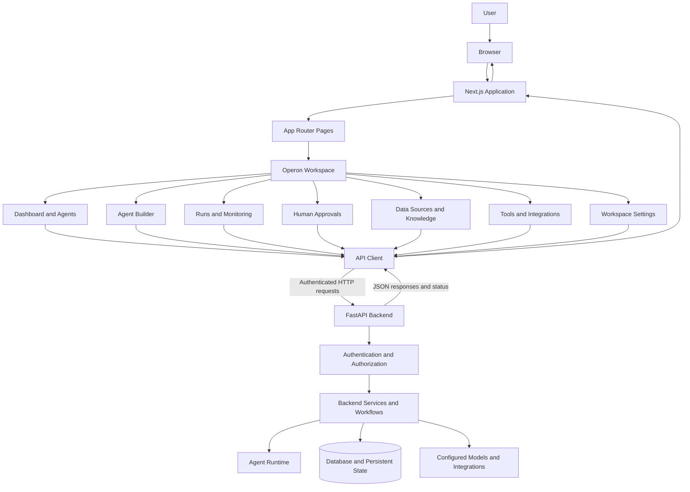
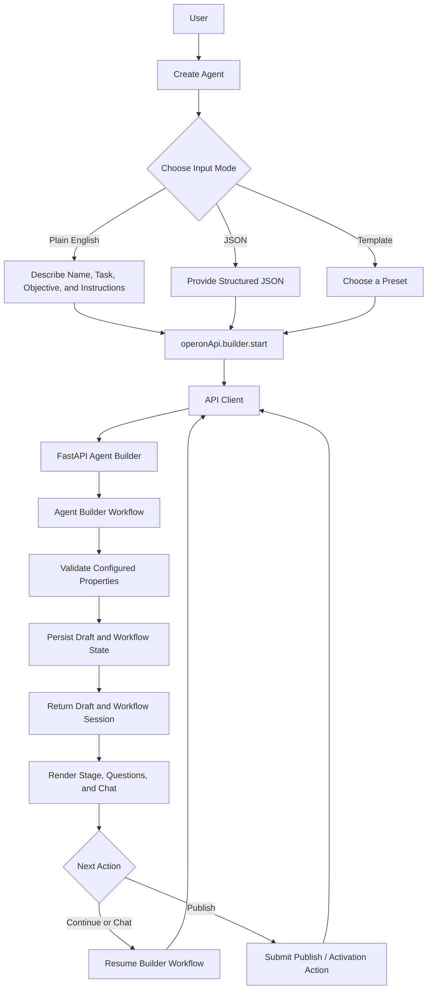
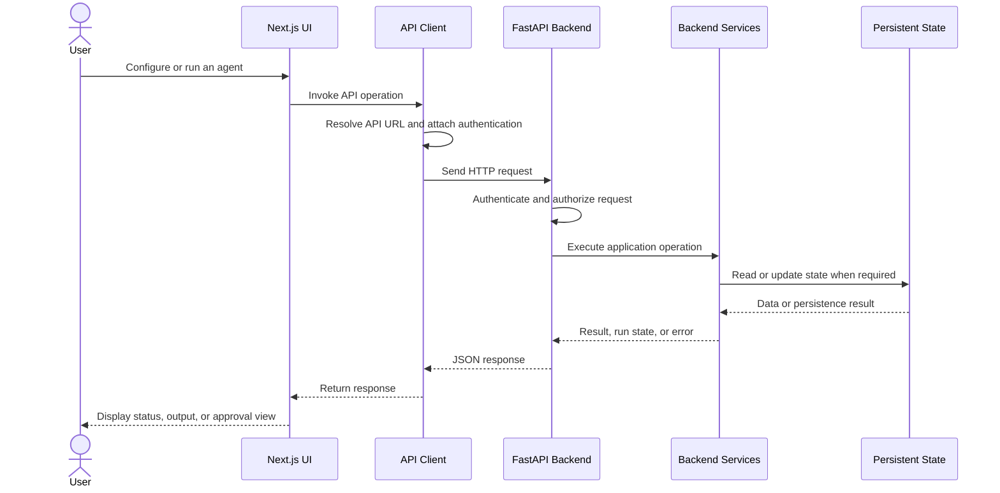
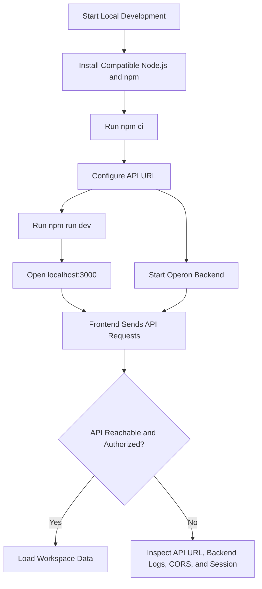
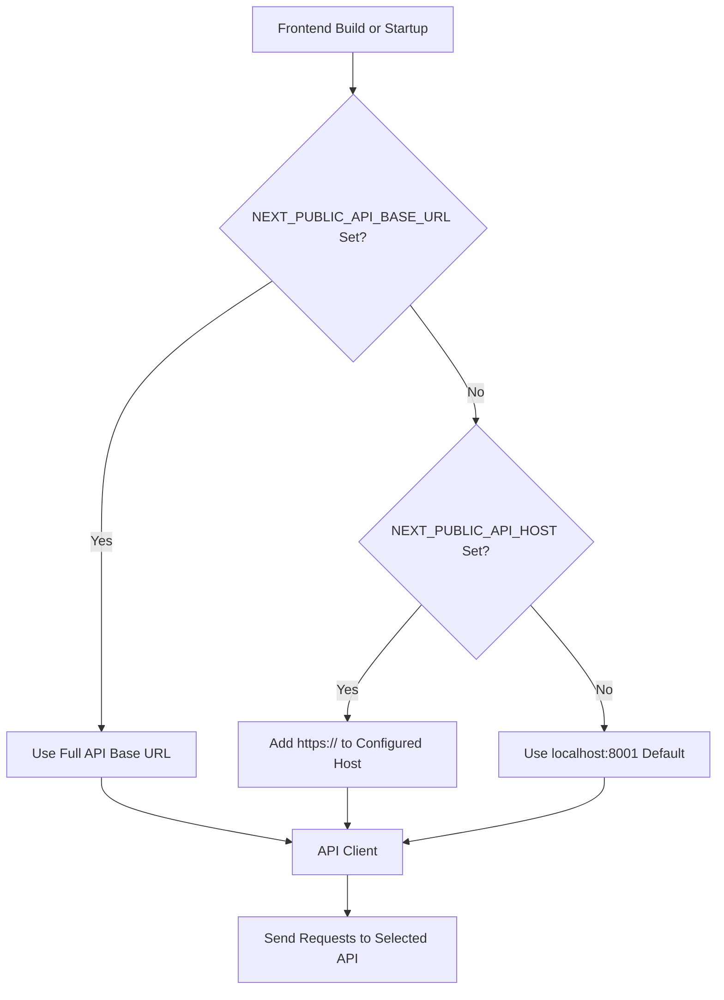
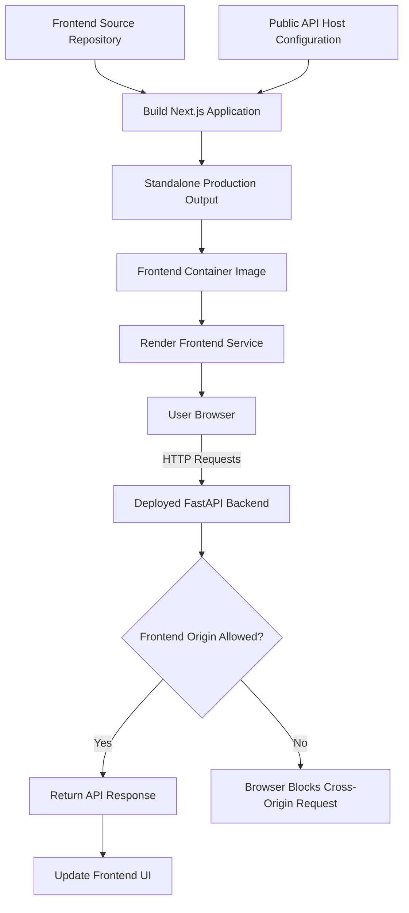

# Operon Frontend

Operon is an AI agent operations platform. Its frontend is a Next.js application for configuring agents, managing integrations and data sources, testing agents, reviewing human approvals, and inspecting agent runs.

The frontend communicates with the Operon FastAPI backend over HTTP. It handles the user interface and browser-side interactions; model inference, agent orchestration, database operations, and private provider credentials remain on the backend.

## Contents

- [Overview](#overview)
- [Core capabilities](#core-capabilities)
- [System architecture](#system-architecture)
- [Workspace and product pages](#workspace-and-product-pages)
- [Agent creation workflow](#agent-creation-workflow)
- [API communication](#api-communication)
- [Technology stack](#technology-stack)
- [Repository structure](#repository-structure)
- [Getting started](#getting-started)
- [Configuration](#configuration)
- [Development commands](#development-commands)
- [Build and deployment](#build-and-deployment)
- [Security and access control](#security-and-access-control)
- [Engineering trade-offs](#engineering-trade-offs)
- [Related documentation](#related-documentation)

---

## Overview

The Operon frontend provides a workspace for managing AI agents throughout their lifecycle, from initial configuration to execution, evaluation, and human review.

The application includes a dashboard, agent builder, agent details, execution monitoring, approval management, knowledge and data-source management, tool configuration, integrations, and platform administration.

The frontend and backend are maintained in separate Git repositories and deployed as separate services.

### Core capabilities

- **Agent configuration:** Create agents from plain-English descriptions, structured JSON, or templates.
- **Agent lifecycle management:** Review configurations, manage versions, and access agent testing and execution controls.
- **Run monitoring:** Trigger and filter agent runs, inspect run state, and view available trace data.
- **Human approvals:** Review pending approval requests and submit approve or reject decisions.
- **Knowledge management:** Manage data sources and knowledge bases used by agent workflows.
- **Tool and MCP management:** Enable tools, manage MCP server connections, and submit tool requests.
- **Integrations:** Browse supported providers and access connection and testing actions.
- **Workspace management:** Navigate workspace settings, switch workspaces, and manage account actions.
- **Platform administration:** View platform tenant metrics and tool-request decisions.

The availability of each capability depends on the corresponding backend endpoint, authentication state, and service configuration.

---

## System architecture

The frontend is responsible for presenting application state and sending requests to the backend. The FastAPI API handles authentication, authorization, application logic, and agent execution.

The frontend does not execute model inference directly in the browser.



### Architectural responsibilities

| Layer | Responsibility |
|---|---|
| Next.js application | Routes, page rendering, and application interface |
| Operon workspace | Agent management, run inspection, approvals, and workspace features |
| API client | API URL selection, request construction, and authenticated HTTP communication |
| FastAPI backend | Authentication, authorization, application logic, and workflow orchestration |
| Backend services | Agent execution, persistence, retrieval, and configured external integrations |
| External providers | Model inference and connected-service functionality |

The frontend and backend can be deployed and scaled independently, but they must use compatible API routes, authentication behavior, and deployment configuration.

---

## Workspace and product pages

The App Router pages under `src/app/` provide the public landing page, login, signup, forgot-password, admin login/signup/overview, and `/operon`.

The `/operon` route is an authenticated workspace shell. Its product areas are rendered as tabs within that shell.

| Workspace area | Main component | Responsibility |
|---|---|---|
| Dashboard & Agents | `components/operon/OperonDashboard.js` | Displays workspace metrics, agents, recent runs, and the entry point for creating agents. |
| Agent Creation | `components/operon/AgentBuilderWorkspace.js` | Guides users through agent creation using plain English, JSON, or a template. |
| Agent Details | `components/operon/AgentDetailView.js` | Displays configuration, versions, testing and run controls, evaluation history, integrations/tools, and deletion actions. |
| Runs | `components/operon/RunsView.js` | Triggers and filters agent runs. `LiveRunModal.js` displays a selected run and available trace data. |
| Human Approvals | `components/operon/ApprovalsView.js` | Lists approval requests and submits approve/reject decisions. |
| Data Sources / Knowledge | `DataSourcesView.js`, `KnowledgeBasesView.js` | Manages connected data sources and user-provided retrieval knowledge. |
| Tools & MCP | `ToolsMcpManager.js` | Enables tools, manages MCP server connections, and submits tool requests. |
| Integrations | `IntegrationsView.js` | Displays the provider catalog and provides connection/testing actions. |
| Platform Admin | `PlatformAdminConsole.js` | Displays platform tenant metrics and tool-request decisions. |
| Workspace Settings | `features/settings/OperonSettingsView.js` | Provides workspace-level settings. |

`OperonNavbar.js` and `OperonSidebar.js` provide navigation, workspace switching, theme control, and account actions.

### Legacy components

Older ticketing, incident-management, analytics, and customer-related experiences remain under `src/components/`. These include:

- `Dashboard.js`
- `TicketsManager.js`
- `HITLWorkspace.js`
- `IncidentsManager.js`
- Related analytics and customer components

`AgentWizard.js` is an older template wizard. The current `/operon` agent creation entry point uses `AgentBuilderWorkspace.js`.

The presence of a legacy component in the repository does not necessarily mean it is part of the current Operon workspace flow.

---

## Agent creation workflow

The agent builder supports three starting modes: a plain-English description, structured JSON, or a predefined template.

The frontend collects the user's input and displays the backend workflow's output. Agent configuration, model calls, integration credentials, and persistent state are handled by the backend.



### Builder implementation

The main frontend entry point is:

`src/components/operon/AgentBuilderWorkspace.js`

The frontend API modules coordinate calls to the backend:

- `src/api/operon.js` groups Operon endpoint calls.
- `src/api/endpoints.js` defines API route paths.
- `src/api/client.js` sends HTTP requests using the configured API URL and authentication.
- `src/context/OperonContext.js` coordinates user and workspace session state.

The builder renders backend workflow output, including the current stage and questions. It does not independently perform model inference or database writes in the browser.

The backend is responsible for plain-English processing, configuration validation, persistence, and the actual agent lifecycle.

---

## API communication

Frontend components use shared API modules instead of independently defining their own API base URLs and request logic.

The general request flow is:



### Request and response responsibilities

**Frontend responsibilities**

- Collect user input.
- Call the appropriate API endpoint.
- Include the user's session token where required.
- Display returned data, validation feedback, status, and errors.
- Refresh relevant UI state after supported operations.

**Backend responsibilities**

- Authenticate users and authorize access to workspace resources.
- Validate requests and enforce application rules.
- Execute agent workflows and external integrations.
- Persist application data and workflow state.
- Return results and errors through API responses.

A successful frontend render does not prove that a backend request, agent run, or external integration succeeded.

---

## Technology stack

| Technology / module | Responsibility |
|---|---|
| Next.js | Application framework, routes, and page rendering |
| React | Interactive user interface and reusable components |
| JavaScript | Frontend application logic |
| API client modules | HTTP requests and authentication handling |
| Context modules | Workspace/session state, legacy application state, and theme state |
| Tailwind CSS | Styling and utility-based layout |
| Oxlint | Frontend lint checks |
| Docker | Containerized application packaging |
| Next.js standalone output | Production server runtime |
| Render Blueprint | Deployment configuration for separate frontend and backend services |

---

## Repository structure

The frontend source is under `frontend/` in the combined project checkout.

```text
frontend/
├── public/
├── src/
│   ├── app/
│   ├── api/
│   ├── components/
│   │   ├── operon/
│   │   └── ui/
│   ├── context/
│   ├── features/
│   ├── services/
│   ├── utils/
│   ├── types/
│   ├── assets/
│   ├── config.js
│   └── index.css
├── next.config.mjs
├── tailwind.config.js
├── postcss.config.js
└── package.json
```

### Important directories

| Path | Responsibility |
|---|---|
| `src/app/` | Next.js App Router pages, layouts, metadata, and app icons |
| `src/components/operon/` | Current Operon dashboard, agent builder, agent details, runs, approvals, data sources, knowledge, MCP, integrations, and administration UI |
| `src/components/` | Shared components and older ticketing, incident-management, analytics, and administration features |
| `src/components/ui/` | Shared UI elements, including status badges, loading/empty states, logo, and decision explanations |
| `src/api/` | API client and grouped endpoint calls |
| `src/context/` | Workspace/session, legacy application, and theme state |
| `src/features/` | Reusable authentication and settings views |
| `src/services/` | Frontend service modules, including ticket-related functionality |
| `src/utils/` | Shared helper functions |
| `src/types/` | Shared data shapes and type definitions |
| `src/assets/` and `public/` | Static images, brand assets, and favicon resources |
| `src/config.js` | Frontend configuration |
| `src/index.css` | Global styling |
| `next.config.mjs` | Next.js build and runtime configuration |
| `tailwind.config.js` | Tailwind CSS configuration |
| `postcss.config.js` | PostCSS configuration |

---

## Getting started

### Requirements

- Node.js 22 or a compatible current LTS release.
- npm.
- A running Operon API for authenticated and data-backed features.

### 1. Install dependencies

From the combined repository root:

```powershell
cd frontend
npm ci
```

`npm ci` installs dependencies from the lockfile and is suitable for a reproducible installation.

### 2. Configure the API URL

For local development, the frontend defaults to:

`http://localhost:8001`

You can also configure the API explicitly using a local `.env.local` file.

For example:

```dotenv
NEXT_PUBLIC_API_BASE_URL=http://localhost:8001
```

Use the complete API base URL for `NEXT_PUBLIC_API_BASE_URL`. See the [Configuration](#configuration) section for the supported selection order.

### 3. Start the development server

```bash
npm run dev
```

Open the application at:

`http://localhost:3000`

The backend must be running for authenticated and data-backed features to work. Follow the [backend guide](https://github.com/Operon-Operation-Platform/backend/blob/feat/core-backend-implementation/README.md) to start the API.

### Local development flow



---

## Configuration

The frontend selects its API base URL in the following order:

| Priority | Variable / setting | Behavior |
|---|---|---|
| 1 | `NEXT_PUBLIC_API_BASE_URL` | Uses the full API base URL. |
| 2 | `NEXT_PUBLIC_API_HOST` | Uses the configured hostname and adds `https://`. |
| 3 | Local default | Uses `http://localhost:8001`. |

For example:

```dotenv
NEXT_PUBLIC_API_BASE_URL=https://your-operon-api.example.com
```

Replace the example hostname with the actual API URL for your environment.

### Public environment variables

Next.js `NEXT_PUBLIC_*` variables are exposed to browser code and embedded during the build.

Only public configuration belongs in these variables. Never place API keys, signing secrets, database credentials, model-provider tokens, integration tokens, or private user credentials in frontend environment variables.

### Configuration flow



Use the full API base URL when connecting to a local HTTP service, such as `http://localhost:8001`. The hostname setting adds HTTPS according to the documented selection behavior.

---

## Development commands

Run these commands from the `frontend/` directory.

| Command | Purpose |
|---|---|
| `npm run dev` | Starts the local development server. |
| `npm run lint` | Runs Oxlint checks. |
| `npm run build` | Creates the production build. |
| `npm start` | Serves the standalone build after building. |

### Verify a production build

```bash
npm ci
npm run lint
npm run build
npm start
```

The `npm start` command is intended for serving the built application, not as a replacement for the development server.

---

## Build and deployment

The frontend uses Next.js standalone output to provide a focused production runtime. The frontend is built and deployed separately from the FastAPI backend.

The frontend container listens on port `10000` or the `PORT` supplied by the hosting platform.

The root Render Blueprint references separate frontend and backend repositories/branches and supplies the backend hostname as public frontend configuration.

### Deployment flow



### Deployment checklist

Before releasing a new frontend deployment:

1. Confirm the intended frontend repository and deployment branch.
2. Configure the correct `NEXT_PUBLIC_API_BASE_URL` or `NEXT_PUBLIC_API_HOST`.
3. Build the frontend with the intended public API host.
4. Confirm that the container listens on the expected port.
5. Ensure the backend is running and reachable.
6. Ensure the backend CORS configuration allows the deployed frontend origin.
7. Verify authentication, workspace loading, and representative agent workflows.
8. Check browser and backend logs for request failures.

### Build-time configuration

Because `NEXT_PUBLIC_*` values are embedded during the Next.js build, changing the public API hostname requires a new frontend build and deployment.

Changing a Render service name or custom domain can require updates to both the frontend API configuration and the backend's allowed frontend origin.

A reachable frontend does not guarantee that the backend, database, model provider, worker, or integrations are healthy.

---

## Security and access control

### Credential handling

The frontend must receive only public configuration such as:

- `NEXT_PUBLIC_API_HOST`
- `NEXT_PUBLIC_API_BASE_URL`

Do not put the following in frontend source code or `NEXT_PUBLIC_*` variables:

- `SECRET_KEY`
- Database credentials
- Model-provider keys such as `HF_TOKEN`
- Private integration tokens
- Signing secrets or privileged API keys
- Private user credentials

The backend README describes the backend's credential types, encryption, and provider configuration.

### Authentication and workspace isolation

The API client sends the user's session token to the configured API where required. The backend must enforce authentication and workspace authorization for every protected request.

Hiding data or filtering records in React is not an authorization boundary. The backend must validate ownership and permissions regardless of how the request was initiated.

### Cross-origin requests

When the frontend API URL changes:

1. Rebuild the frontend with the intended public API URL.
2. Configure the backend to allow the deployed frontend origin.
3. Verify requests in the browser and inspect the backend response when they fail.

CORS configuration alone is not authentication. It should complement, not replace, server-side authorization.

---

## Engineering trade-offs

| Decision | Benefit | Trade-off / limitation |
|---|---|---|
| Browser-to-API communication | Keeps model work and private credentials on the server; allows frontend and API to scale independently. | Requires a reachable API, valid authentication, compatible deployments, and correct CORS configuration. |
| Next.js standalone output | Creates a focused production runtime. | The public API host is build-time configuration, so changing it requires a new build. |
| Workspace shell with tabs | Keeps common navigation and workspace context in one place. | Each tab still depends on its API endpoints and data-refresh behavior. |
| Real API-backed data | Avoids presenting sample records as customer data. | Empty states are expected when a workspace has no records; API failures need clear error handling. |
| Frontend separated from agent runtime | Keeps inference, integrations, and persistence on the backend. | A visible UI action does not establish that the corresponding backend workflow or provider is operational. |
| Separate frontend/backend deployments | Allows independent builds and releases. | API URL, CORS allowlist, route compatibility, and public environment configuration must remain aligned. |

---

## Related documentation

- [Project overview](../README.md)
- [Operon backend guide](https://github.com/Operon-Operation-Platform/backend)

---

## Operational boundary

The frontend is the control and presentation layer for Operon. It gives users an interface for configuring agents, interacting with backend workflows, inspecting runs, and handling approvals.

The backend remains responsible for executing agent workflows, managing persistence, interacting with model providers and external tools, and enforcing security boundaries.

**A successful frontend build proves that the frontend can be built. It does not, by itself, prove that an agent can execute, a workflow can resume, an approval can be processed, or an integration is healthy.**
